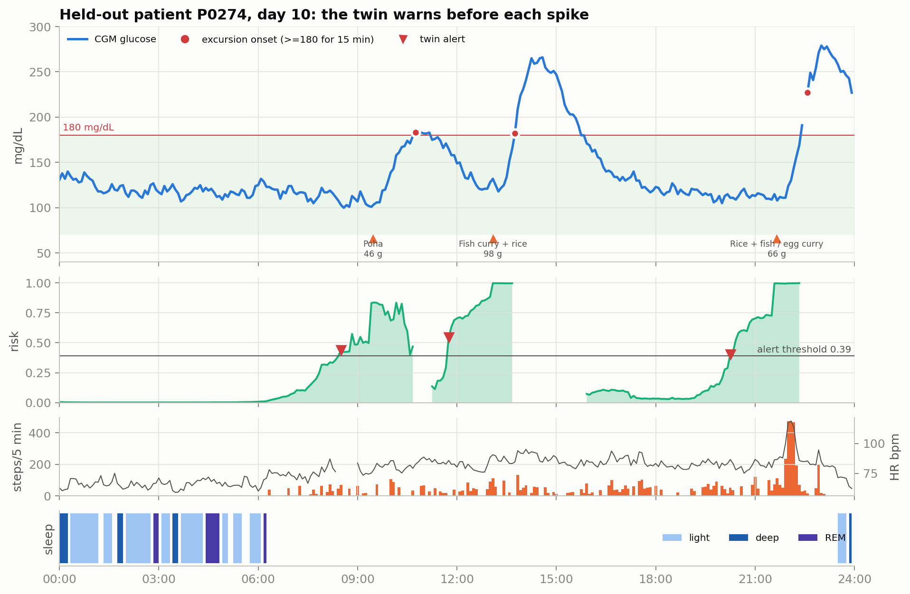
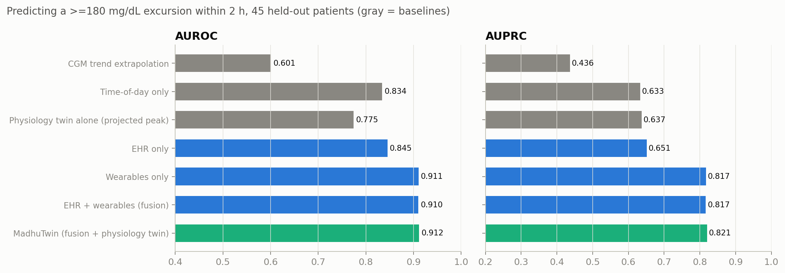
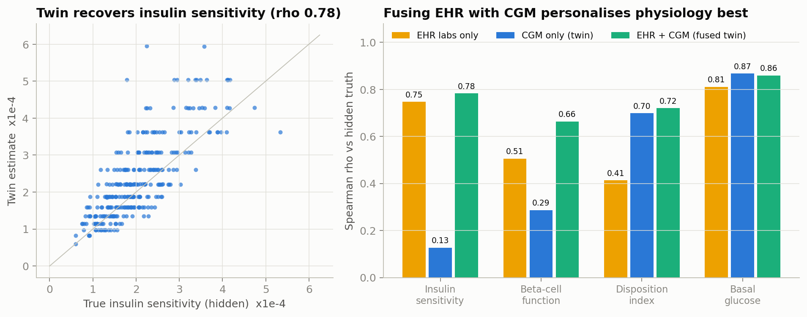
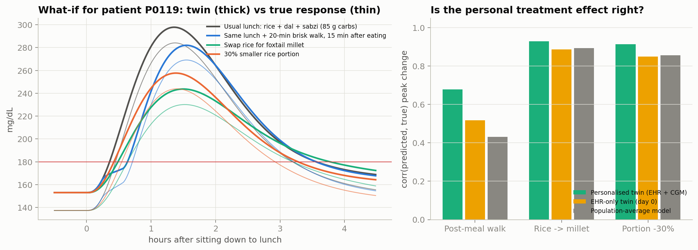
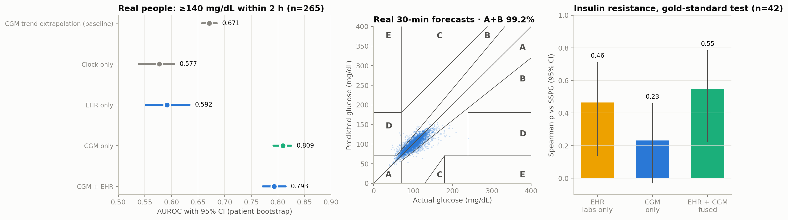
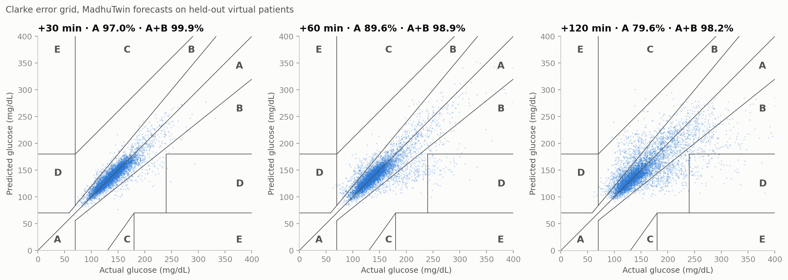
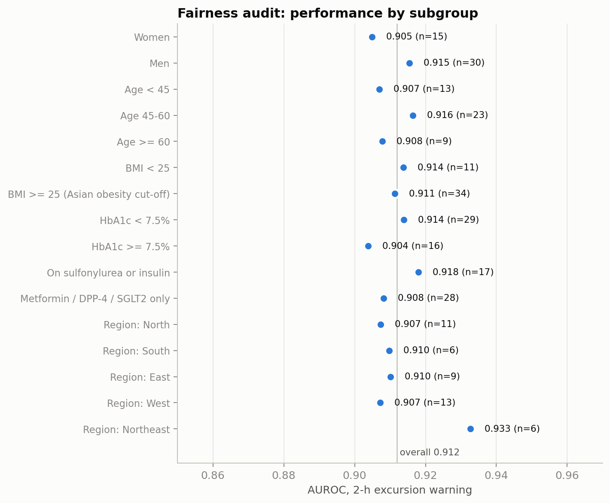
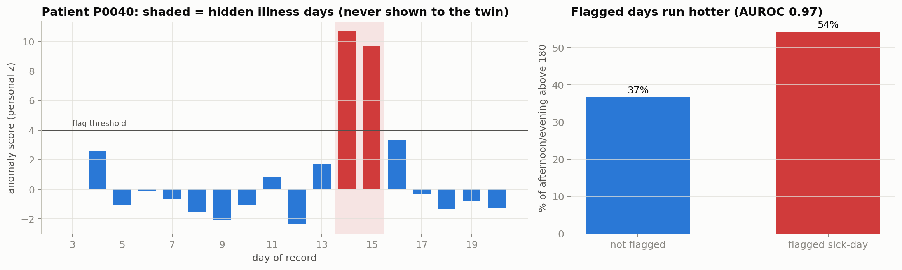
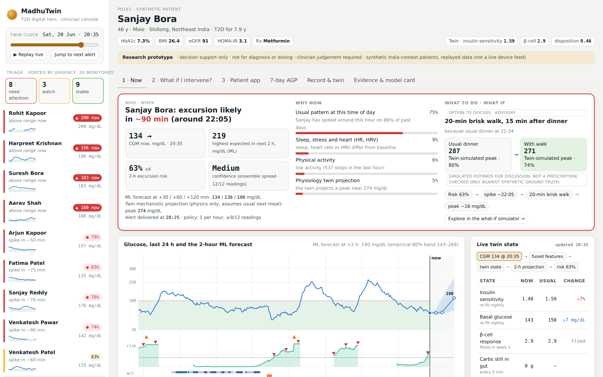

# MadhuTwin: a digital twin for Type 2 Diabetes in India

> **Madhu** (मधु) means honey; *madhumeha* is the Ayurvedic name for diabetes.
> MadhuTwin warns a doctor about a glucose spike **up to 2 hours before it happens**, explains why in plain language, and lets the doctor test **what would prevent it** on a personalised virtual replica of the patient.

Submission for the **Happiest Health Digital Twin Challenge 2026** (Reimagining and Reforming Healthcare in India Summit, Bengaluru), Phase 1: Prototype & Code.

| | |
|---|---|
| **Demo video (16 min, unlisted YouTube)** | *link added after upload* (16 min video; run `python scripts/set_links.py`) · narrated walkthrough of the problem, data, Twin, results, every console screen, the open-cohort check and the deployment path |
| **Presentation** | [`docs/MadhuTwin_Presentation.pdf`](docs/MadhuTwin_Presentation.pdf) · [`.pptx`](docs/MadhuTwin_Presentation.pptx) |
| **Architecture diagram** | [`docs/Architecture_Diagram.pdf`](docs/Architecture_Diagram.pdf) |
| **Doctor's console (runs offline)** | open [`dashboard/madhutwin_console.html`](dashboard/madhutwin_console.html) in any browser |
| **License** | MIT, see [`LICENSE`](LICENSE) |

### Submission checklist (every item the submission form asks for)

✅ = present and checked · ⏳ = present locally, external link still to be added and verified signed-out

| Form item | Where in this README / repo |
|---|---|
| ✅ Team details | [§1 Team details](#1-team-details): Team Vantage; leader Silla Puja; members Shourya Singh, Ridhima Goyal |
| ✅ College / Incubator information | [§1](#1-team-details): Management Development Institute, Gurgaon · Incubator: Not applicable |
| ✅ Project Title | [§2 Project title](#2-project-title) |
| ✅ Problem Statement | [§3 Problem statement](#3-problem-statement-and-healthcare-use-case) |
| ✅ Healthcare Use Case | [§3 Use case](#3-problem-statement-and-healthcare-use-case): T2D, 2-hour warning of a ≥180 mg/dL excursion |
| ✅ Technical Stack | [§4 Technical stack](#4-technical-stack-and-aiml-details) |
| ✅ AI/ML Model or Framework Details | [§4](#4-technical-stack-and-aiml-details) (physiology twin + LightGBM) · [model card](docs/model_card.md) |
| ⏳ 15–20 minute Demo Video (unlisted YouTube) | *link added after upload* (16 min video; run `python scripts/set_links.py`) |
| ✅ Open-source License Details | [§12 License](#12-license): MIT ([`LICENSE`](LICENSE)) |
| ✅ Architecture Diagram (PDF/PPT) | [`docs/Architecture_Diagram.pdf`](docs/Architecture_Diagram.pdf) |
| ✅ Presentation (PDF/PPT) with project details and outcomes | [`docs/MadhuTwin_Presentation.pdf`](docs/MadhuTwin_Presentation.pdf) · [`.pptx`](docs/MadhuTwin_Presentation.pptx) |
| ⏳ All files and links publicly accessible | Every document is in this repo; tick only after the repository and video open in a signed-out (incognito) browser |

Challenge requirements also covered: fusion of static EHR + dynamic wearable data ([§4](#4-technical-stack-and-aiml-details)), a working model that predicts an adverse event in advance ([§6.1](#61-predicting-the-adverse-event)), a clinician dashboard ([§7](#7-the-doctors-console)), synthetic/anonymised data only ([§5](#5-data-sandbox-rules-synthetic--open-data-only)), and one-command reproduction (`python run.py`).

### At a glance

- **Two layers.** *Layer 1, the digital twin*, keeps a live physiological state for each patient: a personalised glucose–insulin model fitted from the EHR and the first week of CGM, updated every 5 minutes and re-personalised every night. *Layer 2, the AI*, predicts from that state plus the raw streams (107 features): risk ± confidence, time to event and the reasons.
- **Predicts the adverse event early (held-out synthetic evaluation):** a ≥180 mg/dL excursion within 2 h, AUROC **0.912** (95% CI 0.905–0.918). Counting only alerts actually delivered (one per hour at most), **75%** of spikes were warned ≥30 min ahead, with a median warning of 75 min and 2.3 false alerts per patient-day.
- **Retrospective open-cohort evaluation:** 265 adults (183 prediabetes, 72 normoglycaemic, 10 T2D), CGM + labs only. Models were re-trained with patient-level cross-validation; no synthetic weights were transferred. For a ≥140 mg/dL event, the **CGM-only** model reached AUROC **0.809** and **CGM + EHR** reached **0.793**.
- **What-if simulator, evaluated against synthetic ground truth:** the predicted benefit of "rice → millet" correlates **0.93** with the true effect in hidden virtual patients. Under a model-mismatch stress test, rankings held but effect sizes were biased (§6.8). Real-patient effects remain unvalidated.
- **The twin's value is measured, not asserted:** it adds **+0.009 AUROC** when only 5 training patients exist, recovers insulin sensitivity at ρ 0.78 (vs 0.13 from CGM alone), and answers what-if questions. With all 210 training patients its AUROC gain is within noise (+0.0007), and we say so (§6.3).
- **A second adverse event:** a sick-day warning from a week of heart rate, HRV and sleep data (AUROC 0.97).
- **Research prototype with a deployment pathway:** India-context synthetic simulation (37 regional foods, Indian routines and prescribing), patient nudges in English and हिन्दी, FHIR R4 *sample* output (ABDM integration is a proposed production path), REST API, Docker and CI. An alert costs about 8 ms of CPU per patient. Data are replayed, not streamed from live devices.

---

## 1. Team details

**Team name:** Team Vantage
**College:** Management Development Institute, Gurgaon
**Incubator:** Not applicable

| Name | Role |
|---|---|
| Silla Puja | Team leader |
| Shourya Singh | Team member |
| Ridhima Goyal | Team member |

## 2. Project title

**MadhuTwin: a hybrid physiology + machine-learning digital twin that predicts post-meal hyperglycaemia 2 hours ahead for people with Type 2 Diabetes in India.**

## 3. Problem statement and healthcare use case

India has about **101 million adults with diabetes (11.4%) and 136 million with prediabetes** (ICMR-INDIAB-17, *Lancet Diabetes & Endocrinology*, 2023). Most care still runs on an HbA1c every three months: an average that hides the steep post-meal spikes driven by high-carbohydrate Indian meals, late dinners and sweet chai. Continuous glucose monitors (CGMs) are becoming common, but doctors see the data only in retrospect. They get no early warning, and no way to know how a specific patient would respond to advice such as "swap white rice for millet" or "walk after lunch".

**Use case.**
- **Condition:** Type 2 Diabetes.
- **Adverse event predicted:** a *glycaemic excursion*, meaning CGM ≥180 mg/dL sustained for ≥15 min (International Consensus on Time in Range), starting within the next **2 hours**, evaluated every 5 minutes while the patient is still in range. Level-2 excursions (≥250 mg/dL) are predicted as well.
- **Users:** diabetologists, physicians and diabetes educators, who triage a panel of CGM-wearing patients, act on early alerts, and personalise lifestyle and medication advice in the consult room.

**What the prototype demonstrates, matching the challenge brief:**
1. **Fusion of two data streams.** Static EHR (demographics, diagnoses, medications, labs, genetic markers) is fused with dynamic wearable/IoT streams (CGM, heart rate, HRV, steps, sleep stages, food log). The fusion happens at two levels: the EHR sets the physiological prior for the twin, and both streams feed the risk model.
2. **A working model that predicts an adverse event in advance:** AUROC **0.912** on synthetic patients never seen in training. From delivered alerts, **75%** of excursions were warned ≥30 min early, with a median warning of **75 min**.
3. **A clinician dashboard** built around one workflow: **who** needs attention → **when** will the event happen → **why** → **what to do** → **what if I intervene?**

## 4. Technical stack and AI/ML details

| Layer | Technology |
|---|---|
| Language / numerics | Python 3.11 · NumPy · pandas · SciPy (fully vectorised ODE solvers; CPU only) |
| Physiology twin | Extended **Bergman minimal model**: glucose, remote insulin action, insulin, delayed β-cell secretion, two-speed gut absorption split by glycaemic index, exercise uptake, renal/SGLT2 clearance, circadian insulin sensitivity, dawn phenomenon |
| Personalisation | **EHR-informed prior with regularised grid-search fitting**: a vectorised coarse-to-fine search (146k simultaneous simulations) penalised for distance from the lab-derived values (HOMA-IR → insulin sensitivity, HOMA-B → β-cell function). This is a MAP-style point estimate, not full Bayesian posterior inference |
| State estimation | Closed-loop observer that assimilates each CGM reading; 2-hour projections from every state (1.8 M projections in seconds) |
| ML | **LightGBM 4.7**: binary classifiers (≥180 and ≥250 mg/dL within 2 h) and quantile regressors (10th/50th/90th percentile at +30/+60/+120 min) |
| Explainability | Native TreeSHAP contributions → plain-language reasons in the console |
| Data formats | Synthea CSV schema with SNOMED CT, LOINC and RxNorm codes; Parquet time series; HealthKit/Health Connect-style long export adapter |
| Console | Dependency-free HTML/CSS/JS + SVG; the twin's equations ported to JavaScript (a parity test pins JS = Python to 1e-6) |
| Uncertainty | 5-model bootstrap ensemble → risk ± SD (model disagreement) and a High / Medium / Low label (Low whenever recent data are insufficient). Split-conformal forecast bands with *empirical* coverage reported per patient |
| Time to event | LightGBM regressors for minutes to onset and 2-h peak |
| Alerting | One policy in [`madhutwin/alerting.py`](madhutwin/alerting.py), shared by evaluation, console and API: threshold, at most 1 alert/hour, suppressed if fewer than 9 of the last 12 CGM readings are present |
| Prediction contract | [`madhutwin/contract.py`](madhutwin/contract.py) defines every output field (endpoint forecast vs 2-h peak vs Twin projection). The API and console use the same names, and a test checks they agree |
| Testing & docs | pytest (28 tests, none skipped: physiology, leakage guards, alert matching, API end-to-end + contract on a committed fixture, JS/Python parity, Clarke, conformal, FHIR), matplotlib, pptxgenjs, Playwright, ffmpeg |

### How it works: EHR + wearables → twin → prediction

```
                       LAYER 1 · DIGITAL TWIN (state)               LAYER 2 · AI PREDICTION
EHR (Synthea schema) ──► prior on physiology ──┐
  HOMA-IR → SI, HOMA-B → σ (regularised fit)          │
                                                ├─► personalised twin ─► patient state vector ─┐
CGM (5 min) ─────────► observer ───────────────┤   SI, σ, Gb, dawn       glucose, gut carbs,     ├─► LightGBM ─► risk ± confidence
meals, steps ────────► twin inputs ─────────────┤   (week 1 + nightly)    insulin action, 2-h     │              time to event, 2-h peak
HR, HRV, sleep ──────► personal baselines ─────┘                         projection              │              reasons (TreeSHAP)
                                                                                                 │                    │
raw streams + EHR ───────────────────────────────────────────────────────────────────────────────┘                    ▼
                                                     what-if engine ◄──── doctor picks an action ◄──── console: who → when → why → what to do
```

**Patient state vector** (what the twin knows about the person at any moment):

| State | Source | Updated |
|---|---|---|
| Plasma glucose (ahead of the lagging sensor) | CGM + observer | every 5 min |
| Carbohydrate still in the gut (fast / slow) | meal log + twin | every 5 min |
| Insulin action, insulin | twin | every 5 min |
| Activity; heart rate vs own baseline | wearable | every 5 min |
| Sleep debt; HRV vs own baseline | wearable | nightly |
| Insulin sensitivity (× personal baseline) | twin re-fit on a rolling 3 days | nightly |
| Basal glucose | twin re-fit on a rolling 3 days | nightly |
| β-cell gain, dawn rise | week-1 fit + EHR prior | weekly |
| HbA1c, eGFR, medicines, comorbidities | EHR | on new result |
| Habitual next meal (time, carbs, GI) | meal log | weekly |

**Digital twin vs ordinary AI.** An ordinary risk model shares one set of weights across everyone and answers “will glucose go high?”. MadhuTwin also keeps a per-person physiology and state, starts from the EHR on day 0, re-personalises nightly, explains a spike mechanistically (carbs in the gut, insulin action) and can simulate an intervention before the doctor recommends it.

1. **Personalise.** From the EHR and the first 7 days of CGM, meals and steps, the twin fits each patient's insulin sensitivity (SI), β-cell secretory gain (σ), basal glucose (Gb) and dawn rise.
2. **Observe.** Every 5 minutes the twin assimilates the new CGM value and updates hidden states the sensor cannot see: carbohydrate still in the gut, insulin action, and plasma glucose ahead of the lagging interstitial sensor.
3. **Project.** It simulates the next 2 hours twice: with food already eaten, and with the patient's *habitual next meal* learned from their own logs.
4. **Fuse and predict.** 107 leak-free features (CGM dynamics and personal history, food log, activity, HR/HRV, sleep, clock, twin states and projections, EHR fields) go into LightGBM. Genotype is kept in the record but **not** used by the risk model: it added nothing (AUROC 0.9123 with vs 0.9117 without), so parsimony wins.
5. **Explain and act.** SHAP values become sentences ("Usual lunch due in 35 min, about 85 g carbs"). The console suggests a next step, and the what-if engine re-simulates the patient's twin with a food swap, smaller portion or post-meal walk, and reports the new peak, time above 180 and event probability. (An SGLT2-inhibitor scenario exists as a research option, hidden from the main demo.)

## 5. Data (sandbox rules: synthetic + open data only)

Training and the full two-stream demo use synthetic patients. A separate retrospective experiment uses open, de-identified real cohorts (section 6.7). No identifiable patient data is used anywhere. [`madhutwin/simulate.py`](madhutwin/simulate.py) generates an **India-context synthetic simulation: 300 virtual adults with T2D × 21 days**, modelled on Indian diets, routines and prescribing (it is not data from Indian patients). Every field, code, unit, coverage figure and missingness rate is listed in [`docs/data_dictionary.md`](docs/data_dictionary.md):

- **EHR** ([`data/ehr/`](data/ehr)): `patients.csv`, `conditions.csv` (SNOMED CT), `medications.csv` (RxNorm), `observations.csv` (LOINC) in the **Synthea CSV schema**, so a real Synthea export can be loaded by the same code. The records include HbA1c history, FPG, fasting insulin, lipids, eGFR, UACR, BP, and **genetic markers** (TCF7L2 rs7903146, KCNJ11 rs5219, FTO rs9939609, South-Asian PRS). Asian BMI/waist cut-offs and Indian prescribing patterns (metformin, sulfonylurea, DPP-4i, SGLT2i, basal insulin) are used.
- **Wearables** ([`data/wearables_5min.parquet`](data/wearables_5min.parquet)): 1.77 M CGM readings plus heart rate, HRV (RMSSD), steps and sleep stages at 5-min resolution. A HealthKit-style long export sample is in [`data/samples/`](data/samples).
- **Food log** ([`data/meal_log.csv`](data/meal_log.csv)): 15,684 logged meals from a **37-item regional Indian food library** (idli, poha, rajma chawal, fish curry-rice, biryani, millets…) with carbs and GI. Logging is deliberately imperfect (about 56% of meals are logged, and carbs are under-estimated), as in real life.
- **Realism:** personal meal habits with day-to-day drift, late dinners, unlogged sweet chai, festival thalis, eating out, office commutes, morning and post-meal walks, 90-minute sleep cycles, stressful days, illness episodes, missed doses, CGM lag/noise/drift/dropouts, and watches taken off to charge.
- **Hidden ground truth** ([`data/truth/`](data/truth)) is used **only for validation**, never as model input. Because every virtual patient has a known "true" physiology, we can test whether the twin actually learned the person.

## 6. Results

### 6.0 Model comparison at a glance

Each row states its cohort, target and split. Rows with different targets are **different experiments** and should not be compared directly.

| Cohort | Target | Split / training | Model | AUROC | AUPRC | Warned ≥30 min (delivered alerts) | False alerts / day |
|---|---|---|---|---|---|---|---|
| Synthetic held-out (45 pts, days 8–21) | ≥180 / 2 h | patient + temporal | CGM trend extrapolation (baseline) | 0.601 | 0.436 | – | – |
| Synthetic held-out (45 pts, days 8–21) | ≥180 / 2 h | patient + temporal | EHR only | 0.844 | 0.651 | – | – |
| Synthetic held-out (45 pts, days 8–21) | ≥180 / 2 h | patient + temporal | Wearables only | 0.911 | 0.817 | – | – |
| Synthetic held-out (45 pts, days 8–21) | ≥180 / 2 h | patient + temporal | EHR + wearables (fusion) | 0.911 | 0.817 | – | – |
| Synthetic held-out (45 pts, days 8–21) | ≥180 / 2 h | patient + temporal | **Fusion + Twin (MadhuTwin)** | 0.912 | 0.819 | 75% | 2.3 |
| Mismatched generator (90 pts) | ≥180 / 2 h | new cohort, model transferred | Fusion + Twin (not retrained) | 0.918 | 0.836 | 73% | 2.7 |
| Open cohorts, real (265 people) | ≥140 / 2 h | patient-level 5-fold CV, re-trained | CGM trend extrapolation (baseline) | 0.671 | 0.201 | – | – |
| Open cohorts, real (265 people) | ≥140 / 2 h | patient-level 5-fold CV, re-trained | CGM only | 0.809 | 0.347 | – | – |
| Open cohorts, real (265 people) | ≥140 / 2 h | patient-level 5-fold CV, re-trained | CGM + EHR (fusion) | 0.793 | 0.328 | – | – |

**Splits and leakage controls.**
- **Patient-level split:** 210 train / 45 validation / 45 test patients. No person appears in more than one set, so every test number is for people the model never saw.
- **Temporal split:** the twin is personalised on days 1–7 only; all evaluation is on days 8–21. Meal habits are learned from week 1 only.
- **Causal features:** every feature at time *t* uses data at or before *t*. Personal baselines (night heart rate, spike history) use completed previous nights or days only. Labels look 2 h ahead and are never features. Automated tests ([`tests/`](tests)) guard against leakage.
- **Threshold and conformal margins** are chosen on the validation patients, never on test.
- **Decision rows** need a current CGM reading below 180 mg/dL. Rows whose next 2 h of CGM is mostly missing are excluded from scoring because their label is undefined.

Test evaluation covers days 8–21 at every 5-min step (125,556 decisions; excursion prevalence 28%).

### 6.1 Predicting the adverse event

| Metric | Value |
|---|---|
| AUROC (excursion ≥180 within 2 h) | **0.912** (95% CI 0.905–0.918) |
| AUPRC | 0.819 |
| Brier score (well calibrated, see `reports/figures/fig_calibration.png`) | 0.105 |
| Sensitivity / specificity at threshold 0.40 | 75% / 89% |
| Level-2 excursion (≥250) AUROC | 0.926 |
| **Excursions warned ≥30 min before onset (delivered alerts)** | **75%** of 2,001 (95% CI 70%–79%) |
| Excursions warned ≥60 min before onset | 61% |
| Median warning time (delivered alert → onset) | **75 min** |
| Alerts per patient-day · precision | 6.7 · 66% followed by an excursion within 2 h |
| False alerts per patient-day | 2.3 (95% CI 2.1–2.5) |
| Calibration: expected calibration error (ECE) | 0.009 |
| Model-disagreement label: share of decisions rated *High* (ensemble SD < 0.04) | 86% (AUROC 0.928 on those vs 0.720 on the rest). This is not a calibrated clinical confidence |
| **When:** time-to-onset error (events that happened) | 17 min (vs 30 min for a constant guess); 81% within ±30 min |
| **How high:** 2-h peak error | 18.4 mg/dL (twin physics alone 25.6) |

**Alert policy and event matching** ([`madhutwin/alerting.py`](madhutwin/alerting.py)). The policy is applied in four steps:

1. A decision is made every 5 min while the current CGM reading is present and below 180 mg/dL.
2. An alert is delivered when risk ≥ threshold, at most one per 60 min, and only if at least 9 of the last 12 readings are present.
3. An excursion counts as *detected* if a delivered alert falls in the 2 h before its onset. Matching is one-to-one: each onset takes the earliest unused alert in its window. Lead time is the gap between that alert and the onset.
4. A delivered alert with no onset in the following 2 h is a *false alert*.

Detection, lead time, precision and false alerts all come from this one alert stream. The console shows the same alerts. An earlier version scored detection from raw threshold crossings, which overstated it (81% warned ≥30 min ahead, median 105 min); the figures above replace it.

**Operating point.** The default threshold (0.40) maximises F1 on the validation patients. It is a reproducible rule for the demo, not a clinically optimised operating point. *We optimise for useful alerts, not maximum sensitivity.* A clinic would choose its own trade-off:

| Threshold | Warned (any lead) | ≥30 min early | ≥60 min early | Median lead | Alerts/day | False alerts/day | Precision |
|---|---|---|---|---|---|---|---|
| 0.25 | 90% | 79% | 69% | 80 min | 8.3 | 3.5 | 57% |
| 0.40 (default) | 86% | 75% | 61% | 75 min | 6.7 | 2.3 | 66% |
| 0.50 | 84% | 72% | 55% | 70 min | 5.8 | 1.7 | 71% |
| 0.60 | 81% | 68% | 49% | 70 min | 5.1 | 1.2 | 76% |
| 0.70 | 77% | 63% | 40% | 60 min | 4.2 | 0.8 | 82% |
| 0.80 | 72% | 55% | 26% | 45 min | 3.3 | 0.4 | 88% |



### 6.2 What each data stream contributes (ablation)

| Features | AUROC | AUPRC | AUROC for events ≥60 min away |
|---|---|---|---|
| CGM trend extrapolation *(baseline)* | 0.601 | 0.436 | – |
| Time-of-day only *(baseline)* | 0.834 | 0.633 | – |
| Physiology twin alone (projected peak) *(baseline)* | 0.775 | 0.637 | – |
| EHR only | 0.844 | 0.651 | 0.830 |
| Wearables only | 0.911 | 0.817 | 0.876 |
| EHR + wearables (fusion) | 0.911 | 0.817 | 0.876 |
| MadhuTwin (fusion + physiology twin) | 0.912 | 0.819 | 0.877 |

**What we found.** Wearables carry most of the short-term signal. Once a week of CGM exists, the patient's own glucose history (for example "spikes at this time on 83% of past days") dominates, and adding the EHR changes the 2-hour alarm very little. Even in a cold-start test (a new patient's first 48 h), AUROC went from 0.884 with wearables only to 0.887 with fusion + twin. We report this honestly. **The EHR earns its place in the twin**, as the next two tables show.

### 6.3 What does the twin measurably add?

Same LightGBM, same data, trained with and without the twin's features; scored on the same 45 held-out patients.

| Training patients | AUROC without twin | AUROC with twin | AUROC gain | AUPRC gain |
|---|---|---|---|---|
| 5 | 0.881 | 0.890 | **+0.009** | +0.025 |
| 10 | 0.891 | 0.896 | **+0.005** | +0.015 |
| 20 | 0.896 | 0.899 | **+0.003** | +0.011 |
| 40 | 0.900 | 0.901 | **+0.001** | +0.005 |
| 80 | 0.907 | 0.908 | **+0.001** | +0.004 |
| 210 (all) | 0.911 | 0.912 | +0.0007 (95% CI -0.0004 to +0.0020) | +0.0021 |

At matched sensitivity (75% of spikes flagged ≥30 min early), false alerts are 2.23/day without the twin and 2.30/day with it.

**Honest reading.** With 210 training patients, the ML layer already learns most of what the twin knows from the raw streams, so the gain is within noise. The twin earns its place:
1. **when data are scarce** (a new clinic with few patients; see the rows above), and when a new patient has no CGM history yet (day-0 personalisation from the EHR, below);
2. **in estimating the physiology** (§6.4);
3. **in counterfactuals** (§6.5), which a prediction model cannot answer at all;
4. **in tracking change.** The nightly re-fit estimated insulin sensitivity at ×0.85 of baseline during illness vs ×0.99 when well. Basal glucose shifted +6.0 mg/dL after 3 missed medication days, vs +0.5 with none.

**Twin maturity.** Rank correlation of the twin's estimates with the hidden true physiology after *n* days of CGM:

| Days of CGM | Insulin sensitivity | β-cell gain | Disposition index | Basal glucose |
|---|---|---|---|---|
| 0 (EHR prior only) | 0.75 | 0.51 | 0.45 | 0.81 |
| 1  | 0.75 | 0.61 | 0.56 | 0.83 |
| 2  | 0.78 | 0.65 | 0.69 | 0.84 |
| 3  | 0.77 | 0.65 | 0.69 | 0.85 |
| 5  | 0.78 | 0.66 | 0.72 | 0.85 |
| 7  | 0.78 | 0.66 | 0.72 | 0.86 |

### 6.4 Does the twin learn the real person? (fusion at the physiology level)

Spearman correlation between the twin's estimate and each patient's hidden true physiology (all 300 patients):

| Parameter | EHR labs only | CGM-only twin | **EHR + CGM twin** |
|---|---|---|---|
| Insulin sensitivity (SI) | 0.75 | 0.13 | **0.78** |
| Beta-cell function (σ) | 0.51 | 0.29 | **0.66** |
| Disposition index (SI × σ) | 0.41 | 0.70 | **0.72** |
| Basal glucose (Gb) | 0.81 | 0.87 | **0.86** |

CGM alone cannot tell insulin resistance apart from weak insulin secretion, because the two trade off. Labs alone are noisy. Combined through the EHR-informed prior and a regularised fit, they recover both. These correlations are against the simulator's hidden truth, and the simulator shares the Twin's equations, so they are an upper bound (see the stress test in §6.8).

### 6.5 How accurate is the what-if simulator? (synthetic ground truth)

Each intervention was re-simulated on the hidden true virtual patient and compared with each model's predicted change in peak glucose (45 test patients). This is a synthetic benchmark, not clinical validation:

| Correlation with the true effect | **Personalised twin** | EHR-only twin (day 0) | Population-average model |
|---|---|---|---|
| 20-min walk after lunch | **0.68** | 0.52 | 0.43 |
| Rice → foxtail millet | **0.93** | 0.89 | 0.89 |
| 30% smaller portion | **0.91** | 0.85 | 0.86 |
| Ranking patients by usual post-lunch peak (Spearman) | **0.92** | 0.72 | 0.65 |

On average, swapping rice for foxtail millet lowered the true peak by 53 mg/dL, a 30% smaller portion by 40 mg/dL, and a 20-min walk by 14 mg/dL. The personalised twin captures *who* benefits most. A pure prediction model cannot answer these questions at all. These outputs are **simulated estimates for discussion, not treatment prescriptions**, and their real-patient accuracy is unknown.

### 6.6 Glucose trajectory forecasts (MAE, mg/dL)

| Horizon | **MadhuTwin** | ML without twin features | Twin physics alone | Persistence | 80% band, empirical coverage |
|---|---|---|---|---|---|
| +30 min | 8.2 | 8.3 | 12.4 | 13.0 | 78% |
| +60 min | 13.5 | 13.7 | 18.8 | 22.3 | 79% |
| +120 min | 21.0 | 21.2 | 29.1 | 34.5 | 80% |





### 6.7 Retrospective open-cohort evaluation (n=265; CGM + labs only)

**What this is:** a retrospective, cross-validated experiment on open data. It is **not** external validation of the synthetic-trained Twin. We re-ran the CGM + EHR part of the pipeline on two open, CC-BY licensed research cohorts of real adults with CGM traces *and* lab records ([`madhutwin/realworld.py`](madhutwin/realworld.py)):

- **Hall et al. 2018, *PLOS Biology* ("Glucotypes", Stanford)**: 57 adults, about 7 days of CGM, with age, BMI, HbA1c, FPG, OGTT, fasting insulin, lipids, hs-CRP and **SSPG** (the gold-standard insulin-suppression test).
- **Colas et al. 2019, *PLOS ONE***: 208 adults at risk of T2D, about 2 days of CGM, with sex, age, BMI, fasting glucose and HbA1c.

Together: 183 prediabetes, 72 normoglycaemic, 10 T2D. Pre-processed copies come from the GlucoBench repository (Sergazinov et al., ICLR 2024). Because most participants are not yet diabetic, the event is **≥140 mg/dL for ≥15 min within 2 h** (prevalence 9.5%). **Synthetic → real bridge.** The models are **not** transferred from the synthetic cohort. The same pipeline (feature definitions, LightGBM settings, evaluation code) is **re-trained and evaluated on the real people** with patient-level, cohort-stratified 5-fold cross-validation, so every prediction is for a person the model never saw. This tests whether the *method* works on real physiology, not whether synthetic weights transfer. The cohorts have no meal logs or smartwatch data, so the twin's meal and activity features are not tested here.

| Features (real people) | AUROC (95% CI) | AUPRC |
|---|---|---|
| CGM trend extrapolation (baseline) | 0.671 (0.658–0.685) | 0.201 |
| Clock only | 0.577 (0.539–0.605) | 0.117 |
| EHR only | 0.592 (0.552–0.634) | 0.132 |
| CGM only | 0.809 (0.792–0.825) | 0.347 |
| CGM + EHR (MadhuTwin fusion) | 0.793 (0.772–0.814) | 0.328 |

| Real-world forecast | MAE (mg/dL) | 'No change' MAE | Clarke A+B |
|---|---|---|---|
| +30 min | 6.7 | 7.9 | 99.2% |
| +60 min | 10.1 | 11.4 | 98.1% |
| +120 min | 12.4 | 14.6 | 97.0% |

| Estimating insulin resistance (SSPG, n=42) | Spearman ρ (95% CI) |
|---|---|
| EHR labs only | 0.46 (0.14–0.71) |
| CGM only | 0.23 (-0.03–0.46) |
| EHR + CGM (fused) | 0.55 (0.23–0.78) |

**Headline, labelled.** For a ≥140 mg/dL event within 2 h, the **CGM-only** model reached AUROC **0.809** (0.792–0.825). **CGM + EHR fusion** reached **0.793** (0.772–0.814). The 0.809 figure is the CGM-only model, not the full system.

**What it cannot validate:** only 10 participants have type 2 diabetes. There are no meals or wearables, so the two-stream fusion, the full Twin workflow and performance in Indian patients remain untested on real people.

**Reading.** On real people the 2-hour alarm is carried by the CGM signal, and adding the lab record did not improve it, even in the first 24 h of wear (0.798 vs 0.789). Labs plus CGM *did* give the best estimate of measured insulin resistance, though with only 42 people the confidence intervals overlap. This matches the synthetic finding: **the EHR personalises the physiology; the CGM drives the alarm.**



### 6.8 Model-mismatch stress test

The main synthetic benchmark generates patients with the same equations the Twin uses, which flatters the Twin. [`scripts/stress_test.py`](scripts/stress_test.py) generates 90 new patients with deliberately different physiology. The differences are:

- gut absorption: fast chain ×0.65, slow chain ×1.5, and a different GI split;
- insulin clearance ×1.3 and slower secretion;
- 13-min sensor lag and 1.6× sensor noise;
- a stronger insulin-sensitivity rhythm peaking at 08:00;
- 30% fewer logged meals.

The Twin and all trained models were used **unchanged**.

| Measure | Matched benchmark | Mismatched generator |
|---|---|---|
| Risk AUROC (model transferred, not retrained) | 0.912 | 0.918 |
| CGM-trend baseline AUROC | 0.601 | 0.622 |
| Spikes warned ≥30 min ahead (delivered alerts) | 75% | 73% |
| False alerts per patient-day | 2.3 | 2.7 |
| Insulin sensitivity recovered by the Twin (ρ) | 0.78 | 0.75 |
| What-if walk: effect correlation · mean effect true vs Twin | 0.68 | 0.66 · -9 vs -16 mg/dL |
| What-if rice → millet: effect correlation · mean effect true vs Twin | 0.93 | 0.87 · -40 vs -57 mg/dL |
| What-if smaller portion: effect correlation · mean effect true vs Twin | 0.91 | 0.87 · -42 vs -42 mg/dL |

**Reading.** Risk discrimination and physiology recovery held up: the risk model is driven mostly by CGM patterns, and the EHR prior carries insulin sensitivity. The Twin still ranked *who* benefits from an intervention, but effect *sizes* were biased when its assumptions were wrong. For example, it over-estimated the millet benefit. Treat what-if magnitudes as approximate until they are validated on real patients.

### 6.9 Evaluation details: Clarke error grid, empirical uncertainty, subgroup performance

This section is a held-out synthetic evaluation, plus the exploratory retrospective evaluation on open cohorts above. No prospective clinical study has been done.

Forecasts are scored on the **Clarke error grid** (A = clinically accurate, B = benign, C–E = errors that could change treatment wrongly). Prediction bands are **split-conformal** calibrated on the validation patients. We report the *empirical* coverage observed on held-out synthetic patients, overall and patient by patient. Rows within a patient are correlated, so this is not a formal guarantee. Every headline metric carries a **95% CI from resampling patients**.

| Horizon | Zone A | Zone B | Zone C | Zone D | Zone E | 80% band coverage (raw → conformal) |
|---|---|---|---|---|---|---|
| +30 min | 97.0% | 2.9% | 0.00% | 0.13% | 0.00% | 76% → **78%** |
| +60 min | 89.7% | 9.2% | 0.00% | 1.12% | 0.00% | 74% → **79%** |
| +120 min | 79.6% | 18.5% | 0.19% | 1.66% | 0.00% | 74% → **80%** |

| Horizon | Empirical coverage, all decisions | Median patient | 10th–90th percentile of patients |
|---|---|---|---|
| +30 min | 78% | 78% | 70–87% |
| +60 min | 79% | 79% | 73–85% |
| +120 min | 80% | 80% | 76–85% |

**Subgroup performance (exploratory).** AUROC of the 2-hour warning by subgroup on the small synthetic test set, with patient-bootstrap 95% CIs. This is a diagnostic, not proof of fairness. A subgroup release gate is a proposed governance step, not an operational one.

| Subgroup | Patients | Event rate | AUROC (95% CI) |
|---|---|---|---|
| Women | 15 | 29% | 0.904 (0.89–0.92) |
| Men | 30 | 28% | 0.915 (0.91–0.92) |
| Age < 45 | 13 | 30% | 0.907 (0.90–0.92) |
| Age 45-60 | 23 | 27% | 0.916 (0.91–0.92) |
| Age >= 60 | 9 | 28% | 0.908 (0.89–0.92) |
| BMI < 25 | 11 | 31% | 0.913 (0.90–0.92) |
| BMI >= 25 (Asian obesity cut-off) | 34 | 27% | 0.911 (0.90–0.92) |
| HbA1c < 7.5% | 29 | 25% | 0.914 (0.91–0.92) |
| HbA1c >= 7.5% | 16 | 35% | 0.903 (0.89–0.91) |
| On sulfonylurea or insulin | 17 | 27% | 0.918 (0.91–0.93) |
| Metformin / DPP-4 / SGLT2 only | 28 | 29% | 0.908 (0.90–0.91) |
| Region: North | 11 | 26% | 0.907 (0.90–0.92) |
| Region: South | 6 | 31% | 0.910 (0.89–0.93) |
| Region: East | 9 | 27% | 0.910 (0.90–0.92) |
| Region: West | 13 | 27% | 0.907 (0.89–0.92) |
| Region: Northeast | 6 | 34% | 0.932 (0.91–0.94) |




### 6.10 A second adverse event: sick-day warning from a week of HR, HRV and sleep

The brief's second example is flagging an anomaly from a week of sleep and heart-rate data. For diabetes the most actionable one is **intercurrent illness**, which raises glucose for days and calls for "sick-day rules". Each morning [`madhutwin/sickday.py`](madhutwin/sickday.py) compares last night's sleeping heart rate, HRV, sleep and yesterday's activity with the patient's own previous 7 nights.

| Metric (45 held-out patients) | Value |
|---|---|
| AUROC, unsupervised personal-baseline score (no labelled training data) | **0.966** |
| AUROC, supervised daily model | 0.999 |
| Illness days flagged at z ≥ 4 | 78% |
| False flags per patient-week | 0.12 |
| Time above 180 for the rest of the day: flagged vs not flagged | 54% vs 37% |

The flag is advisory: the console suggests that a clinician *consider* sick-day guidance, and any medication review stays a clinician decision. Caveat: illness effects in the simulator are clear-cut, so real-world performance will be lower. Detecting infection from consumer wearables (resting heart rate, HRV) is well documented, which is why the score is built on those signals.



## 7. The doctor's console

Open `dashboard/madhutwin_console.html`. It is a single self-contained file that works offline with no install. It **replays** recorded synthetic data five minutes at a time; it is not connected to live devices. A permanent banner reads: *research prototype · decision support only · not for diagnosis or dosing · clinician judgement required*.

The console follows one workflow: **Triage → When → Why → What to do → What if I intervene → Outcome**.

| View | What the doctor does |
|---|---|
| **Triage rail** | Counts of *attention / watch / stable*; patients sorted by **risk × severity × confidence × time to event**; *Replay live* streams the twin forward |
| **1 · Now (hero)** | One card shows the risk with its ensemble spread and confidence label, the expected **time to event**, and three clearly labelled numbers. Below them come the top reasons with **% share** and one *advisory* option to discuss, which opens the what-if. When fewer than 9 of the last 12 readings are present, the card switches to "insufficient recent CGM data" and alerts are suppressed. The three numbers are:<br>• **highest glucose expected in the next 2 h (ML)**;<br>• the **ML forecast at +30/+60/+120 min**;<br>• the **Twin's mechanistic projection**, which assumes the usual next meal. |
| **Twin state** (in *Now*) | The live patient state vector, and **today vs the patient's own baseline** (glucose, insulin sensitivity, basal glucose, night HR, HRV, sleep, steps) |
| **2 · What if I intervene?** | Food swap, portion, post-meal walk. The patient's Twin re-simulates in the browser and shows **baseline vs intervention**: peak, time to peak, minutes >180, event probability and the improvement. Results are labelled *simulated estimates for discussion, not prescriptions*, next to the synthetic validation and the stress-test caveat |
| **7-day AGP** | Ambulatory glucose profile, TIR/TAR/TBR bar, GMI, CV against International Consensus targets, lifestyle summary |
| **Record & physiology** | Labs with targets, HbA1c trend, diagnoses, medications, genotype, the twin's SI / β-cell / disposition index, learned meal habits |
| **Sick-day check** (in *Now*) | Last night's heart rate, HRV and sleep vs the patient's own week; flags likely illness and prompts sick-day rules |
| **Patient app** | What the patient sees: one nudge before the usual meal, in **English or हिन्दी**, plus a sick-day banner |
| **Evidence & model card** | Twin value; operating point and why; calibration with ECE and per-patient band coverage; synthetic → real bridge; the open-cohort results labelled by model and target, with cohort mix; the model-mismatch stress test; data provenance; leakage controls; subgroup CIs; latency; limitations |

**Prediction contract.** [`madhutwin/contract.py`](madhutwin/contract.py) documents every field. The REST API returns exactly these fields, and the console shows the same values. `tests/test_api.py` checks that the API, computing live from the saved models, reproduces the console's numbers for fixed patients and time points.

| Field | Meaning |
|---|---|
| `forecast_mgdl["+30min" / "+60min" / "+120min"]` | Predicted glucose **at** that time (ML median) |
| `predicted_peak_next_2h_mgdl` | Highest glucose expected at **any** point in the next 2 h (ML). It is never below the current reading or any forecast endpoint |
| `twin_projected_peak_mgdl` | Mechanistic Layer-1 projection that assumes the usual next meal. It is a scenario, not the ML forecast |
| `time_to_onset_min` | Expected minutes until onset. Reported only when risk ≥ threshold |
| `risk_2h`, `risk_sd`, `confidence` | Probability of the target event; ensemble disagreement; High/Medium/Low (Low if data are insufficient) |
| `alert_delivered`, `readings_last_hour`, `data_sufficient` | Alert under the shared policy; data-quality state |



## 8. Deployment and interoperability

| Piece | What it gives a hospital |
|---|---|
| **FHIR R4 sample output** ([`madhutwin/fhir.py`](madhutwin/fhir.py), sample [`docs/fhir_sample_bundle.json`](docs/fhir_sample_bundle.json)) | A `Bundle` with a pseudonymous `Patient`, the CGM `Observation` (LOINC), the 2-hour `RiskAssessment` (probability, horizon, top reasons) and the Twin's physiology as `Observation`s. ABDM health-information exchange is a **proposed** production path; no live ABDM or hospital integration has been demonstrated |
| **REST API** ([`madhutwin/api.py`](madhutwin/api.py)) | `GET /v1/patients/{id}/risk` (live inference of the full prediction contract), `POST /v1/whatif` (labelled simulated estimate), `GET /v1/patients/{id}/fhir`; interactive docs at `/docs` |
| **Docker** ([`Dockerfile`](Dockerfile)) | `docker build -t madhutwin . && docker run -p 8000:8000 madhutwin` serves the API and the console (`/console/`) on a CPU-only machine |
| **CI** ([`.github/workflows/ci.yml`](.github/workflows/ci.yml)) | The full test suite runs on every push, including the API end-to-end and contract tests on a committed fixture. The job fails if any test is skipped |

**Prototype vs production.**

| | This prototype | Production path |
|---|---|---|
| Data in | Synthetic CSV/Parquet; open CGM cohorts | ABDM / FHIR R4 from the hospital EHR; Health Connect / HealthKit; CGM vendor APIs |
| Compute | Laptop CPU, no GPU | On-premise or Indian-region cloud, one container per clinic |
| Serving | FastAPI + static console | Same API behind hospital SSO; RiskAssessment written back to the EHR |
| Models | Retrained by script | Versioned registry, drift monitoring, shadow mode before go-live |
| Governance | Research prototype | DPDP consent artefacts, audit log, prospective study, CDSCO SaMD pathway |

**Latency and footprint** (measured by [`scripts/benchmark.py`](scripts/benchmark.py)):

| Step | Time |
|---|---|
| Twin state update (one patient, one 5-min step) | 0.032 ms |
| Twin 2-hour projection | 0.82 ms |
| Risk inference | 0.03 ms |
| Risk + SHAP reasons | 6.78 ms |
| **End-to-end alert per patient per 5 min** | **8.4 ms** |
| What-if 5-hour simulation | 14.5 ms |
| REST API `/risk` request | 16.8 ms |
| All model files on disk | 25.7 MB |
| Hardware | 2-core x86 CPU, no GPU, Python 3.11.15 |

One CPU core can refresh roughly **35,502 patients every 5 minutes**.

## 9. Run it yourself

```bash
pip install -r requirements-lock.txt   # exact versions used for every number here
python run.py                          # tests → twin → models → evaluation → latency → console (skips the open-cohort experiment)
python run.py --full                   # also re-simulates the cohort, runs the open-cohort experiment, rebuilds docs
python scripts/stress_test.py          # model-mismatch stress test -> reports/stress_test.json (about 1 min)
python run.py --serve                  # REST API + console at http://127.0.0.1:8000/docs and /console/
```

**Reproducibility.** Python 3.11, CPU only, versions pinned in [`requirements-lock.txt`](requirements-lock.txt). All randomness is seeded (`config.SEED = 2026`: cohort simulation, patient split, LightGBM, bootstrap). Every number in this README, the deck and the architecture PDF is read from [`reports/metrics.json`](reports/metrics.json) by the doc builders, never typed by hand. The model card is in [`docs/model_card.md`](docs/model_card.md).
Optional document builders: `python scripts/render_docs.py` (architecture PDF), `node docs/src/build_deck.js` (deck), `python scripts/build_readme.py` (this README), `python docs/src/make_video.py` (narrated video; see header for requirements).
Team details live in [`team.json`](team.json). Edit it once, then re-run the deck and README builders.

### Clean-clone verification (actually run)

| Step | Command | Result |
|---|---|---|
| Clone | `git clone <repo> && cd <repo>` | fresh checkout of the committed files only |
| Install | `pip install -r requirements-lock.txt` | not re-run here: the environment already had exactly these pinned versions installed |
| Tests | `python -m pytest -q -rs` | 28 passed, 0 skipped (3 s) |
| One-command rebuild | `python run.py` | exit code 0 in 14 min: pipeline 810 s, stress test 24 s, benchmark 4 s, console build <1 s |
| Determinism | `compare reports/metrics.json` | identical to the committed run: AUROC 0.9117, warned ≥30 min 74.6%, median lead 75 min, 2.30 false alerts/day, 2-h MAE 21.0 mg/dL; stress-test AUROC 0.9175 |
| Console | `open dashboard/madhutwin_console.html` | opens offline; same alerts and values (checked by tests/test_api.py) |

Run on 2026-10-20 from a fresh `git clone` (commit `84fd9d5`), Python 3.11.15, 2-core x86-64 CPU, no GPU. Expected outputs: `reports/metrics.json`, `reports/latency.json`, `models/*.txt`, `dashboard/madhutwin_console.html`, `tests/fixtures/*`. Not included (regenerated by the pipeline): `data/processed/api_store.parquet` (until it exists, the API serves the committed test fixture) and `realworld_oof.parquet`. Also not included: the raw GlucoBench download (`data/real/README.md` explains how to rebuild `data/real/` from it) and generated large intermediates (`data/processed/features.parquet`, `test_predictions.parquet`), which the pipeline recreates.


## 10. Repository structure

```
madhutwin/            core package
  config.py           thresholds, cohort size, Indian food library (carbs, GI)
  ehr.py              synthetic EHR + Synthea-schema loader (LOINC, SNOMED, RxNorm, genotype)
  simulate.py         virtual-patient simulator: behaviour → physiology → sensors
  physiology.py       glucose–insulin ODEs shared by simulator, twin and what-if
  twin.py             personalisation (EHR prior), observer, habit learning, 2-h projection
  features.py         leak-free fusion of all streams (features every 5 min)
  model.py            LightGBM training, ablations, event-level evaluation
  whatif.py           counterfactual simulation and its validation
  adapters.py         HealthKit / Health Connect style import / export
  realworld.py        retrospective open-cohort experiment, 265 people (Hall 2018, Colas 2019)
  alerting.py         the single alert policy + event matching (evaluation, console, API)
  contract.py         the prediction contract: every output field and its meaning
  sickday.py          sick-day detector from a week of HR / HRV / sleep
  evaluation.py       Clarke grid, patient bootstrap CIs, conformal intervals, subgroup audit
  fhir.py · api.py    FHIR R4 export and REST API
  report.py           figures · export_dashboard.py  console data · pipeline.py  end-to-end
dashboard/            console source, data and single-file build
data/                 synthetic EHR, wearables, meal log, hidden truth, processed features; data/real/ open cohorts
models/               trained LightGBM models + model card
reports/              metrics.json + figures
docs/                 architecture PDF, presentation (PDF/PPTX), model card, data dictionary, sources
tests/                pytest suite
scripts/              benchmark (latency), console / docs / README builders
run.py                one-command reproduction
```

## 11. Privacy, safety and limitations

- **Privacy:** synthetic patients plus open, de-identified research cohorts; no PHI. Real-world data: Hall et al. 2018 (CC-BY 4.0) and Colas et al. 2019 (CC-BY), via GlucoBench; see [`data/real/README.md`](data/real/README.md). The formats map onto ABDM / FHIR R4, and the design assumes on-premise inference and consent under the **DPDP Act 2023**.
- **Intended use:** decision support for clinicians, with suggestions shown as advisory options to discuss. It does no automated dosing, makes no diagnosis, and medication questions go to clinician review. Clinical use would need prospective validation and the CDSCO SaMD pathway.
- **Limitations:**
  - **Synthetic results.** The headline results come from an India-context *synthetic* simulation. The data are replayed, not streamed from live devices.
  - **Open-cohort experiment.** It covers CGM + labs only, in 265 people from the USA and Spain, of whom only 10 have T2D. Models were re-trained there.
  - **Untested on real people:** meal and smartwatch fusion, Indian-population performance and the full Twin.
  - **Shared equations.** The Twin shares equations with the simulator, so Twin-fidelity and what-if numbers are an upper bound. The stress test shows what-if effect sizes become biased when the assumptions are wrong.
  - **Little AUROC gain at scale.** With 200+ training patients the Twin adds little AUROC.
  - **Food-log quality.** Meal-driven predictions depend on it.
  - **Hypoglycaemia** is not yet a target.
- **Next steps:** validate on an Indian CGM cohort with meals and wearables; hypoglycaemia risk for sulfonylurea/insulin users; live ABDM and Health Connect connectors; more Indian languages; a clinician usability study and prospective clinic pilot.

## 12. License

Released under the **MIT License** (see [`LICENSE`](LICENSE)). Third-party libraries keep their own licenses: NumPy, pandas, SciPy and scikit-learn (BSD-3-Clause), LightGBM (MIT), matplotlib (PSF-based), pyarrow (Apache-2.0), Playwright (Apache-2.0), pptxgenjs (MIT). The narration voice was generated with Kokoro-82M (Apache-2.0). Real-world data: Hall et al. 2018 (CC-BY 4.0) and Colas et al. 2019 (CC-BY), processed copies from GlucoBench (Sergazinov et al., ICLR 2024). The Synthea CSV *schema* is used for compatibility; no Synthea data is redistributed.

---
<sub>Research prototype for the Happiest Health Digital Twin Challenge 2026. Not for clinical use.</sub>
